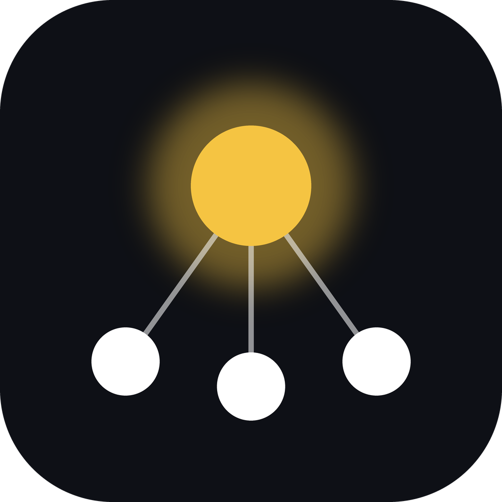

<p align="center"></p>

<h1 align="center">godmodeforclaude</h1>

<p align="center"><b>Modo Deus para o Claude Code:</b> o Opus pensa, planeja e confere; o Haiku faz o trabalho braçal; tudo num loop de verificação até cumprir o objetivo.</p>

<p align="center"><a href="#english">English</a> · <a href="LICENSE">MIT</a></p>

---

## O que é

"Modo Deus" é o apelido de uma combinação, não um botão das configurações. A skill `/godmodeforclaude` monta tudo no seu projeto com um comando:

| Peça | O que faz |
|---|---|
| **Orquestrador** (`.claude/agents/orquestrador.md`) | Roda no **Opus** com esforço **Extra alto**. Planeja, divide o trabalho, delega e confere cada entrega. Só pode delegar para o executor. |
| **Executor** (`.claude/agents/executor.md`) | Roda no **Haiku**. Faz só a etapa que recebeu e devolve a prova: arquivos alterados, comando de verificação e a saída dele. |
| **Configurações** (`.claude/settings.json`) | Abre o Claude Code já como orquestrador, fixa o esforço em Extra alto e compacta o contexto aos 40%. |
| **Regras** (`CLAUDE.md`) | Divisão de papéis, plano e memória em arquivo, skills que se aprimoram e regras de segurança. |
| **Memória** (`memoria/plano.md`) | O plano vivo da tarefa. Depois de uma compactação, o orquestrador relê e não perde o fio. |
| **Skills que se aprimoram** | Cada erro corrigido vira uma lição no `SKILL.md` da skill, com versão (v1, v2...). |

É o padrão orquestrador e subagentes que a Anthropic descreve em [How we built our multi-agent research system](https://www.anthropic.com/research/multi-agent-research-system).

A skill **nunca sobrescreve** o que já existe no seu projeto: ela acrescenta ao `CLAUDE.md`, mescla o `settings.json` preservando o resto e pergunta antes de trocar qualquer agente.

## Requisitos

- [Claude Code](https://code.claude.com/docs) instalado.
- Acesso ao Opus e ao Haiku no seu plano.
- Uma pasta de projeto (pode ser uma pasta nova).

## Instalação

**Opção 1. Como plugin (recomendado):** no Claude Code, rode:

```
/plugin marketplace add ocadubezerra/godmodeforclaude
/plugin install godmodeforclaude@godmodeforclaude
```

Depois use `/godmodeforclaude:godmodeforclaude` (skills de plugin levam o nome do plugin na frente).

**Opção 2. Como skill pessoal (comando curto `/godmodeforclaude`):**

```bash
git clone https://github.com/ocadubezerra/godmodeforclaude.git
mkdir -p ~/.claude/skills
cp -r godmodeforclaude/skills/godmodeforclaude ~/.claude/skills/
```

## Uso

1. Abra o Claude Code na pasta do projeto e rode `/godmodeforclaude`.
   - `/godmodeforclaude 60`: compacta aos 60% (tarefas grandes).
   - `/godmodeforclaude high`: esforço `high` (se o seu Opus não tiver o nível Extra alto).
2. Feche e abra o Claude Code na pasta. Ele abre como orquestrador (`claude --agent orquestrador` também funciona). Aceite a confiança na pasta se for perguntado.
3. Confira com `/model` (Opus) e `/effort status` (xhigh).
4. Dê um objetivo verificável com `/goal`:

```
/goal Todos os testes passam (npm test sem nenhuma falha) e o resumo da entrega está em memoria/plano.md. Mostre a saída do npm test na conversa como prova. Pare depois de 20 turnos se não chegar lá.
```

O avaliador do `/goal` só julga o que aparece na conversa (não roda comando nem abre arquivo), por isso o objetivo pede para mostrar a saída do teste. `/goal` mostra o status e `/goal clear` cancela.

## Estrutura criada

```
CLAUDE.md
.claude/
├─ agents/
│  ├─ orquestrador.md
│  └─ executor.md
├─ skills/
└─ settings.json
memoria/
└─ plano.md
```

## Custo e quando usar

Segundo o artigo da Anthropic, um sistema com Opus liderando subagentes superou o Opus sozinho em 90,2% na avaliação interna deles, mas sistemas multiagente gastam cerca de **15 vezes mais tokens** que uma conversa comum. Use em trabalho grande, com várias partes e que dá para verificar. Para pergunta simples ou ajuste pequeno, converse direto.

## Boas práticas

- **Repositório git:** a skill pergunta se você quer versionar esses arquivos ou mantê-los só na sua máquina (via `.git/info/exclude`).
- **Segurança:** o `CLAUDE.md` gerado proíbe apagar dados, publicar ou fazer deploy sem sua aprovação, e nunca expõe segredos (`.env`, chaves, tokens).
- **Compactação:** `CLAUDE_AUTOCOMPACT_PCT_OVERRIDE` só antecipa a compactação; valores acima do padrão do Claude Code são ignorados.

## Referências

- [How we built our multi-agent research system](https://www.anthropic.com/research/multi-agent-research-system) (Anthropic)
- [Subagentes do Claude Code](https://code.claude.com/docs/en/sub-agents)
- [Comando /goal](https://code.claude.com/docs/en/goal)
- [Skills](https://code.claude.com/docs/en/skills) · [Plugins](https://code.claude.com/docs/en/plugins)

---

<a id="english"></a>
## English

**godmodeforclaude** sets up an orchestrator/worker system in your Claude Code project with one command. An **orchestrator** on **Opus** (extra-high effort) plans, delegates and verifies; a cheap **executor** on **Haiku** does the hands-on work and returns evidence. The plan lives in `memoria/plano.md`, skills record lessons learned and bump their version, and `/goal` keeps the loop running until a verifiable condition is met. It never overwrites existing files: it appends, merges or asks first.

Install as a plugin with `/plugin marketplace add ocadubezerra/godmodeforclaude` and `/plugin install godmodeforclaude@godmodeforclaude`, or copy `skills/godmodeforclaude` to `~/.claude/skills/` to get the short `/godmodeforclaude` command. Generated files are in Brazilian Portuguese. Multi-agent runs use roughly 15× more tokens than a regular chat, so use it for large, verifiable work.

## Licença

[MIT](LICENSE) © 2026 Cadu Bezerra
